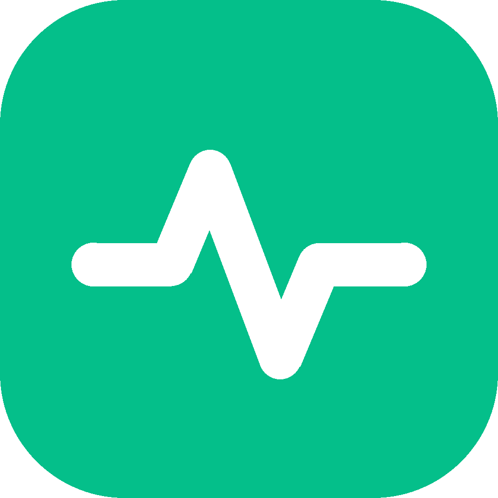
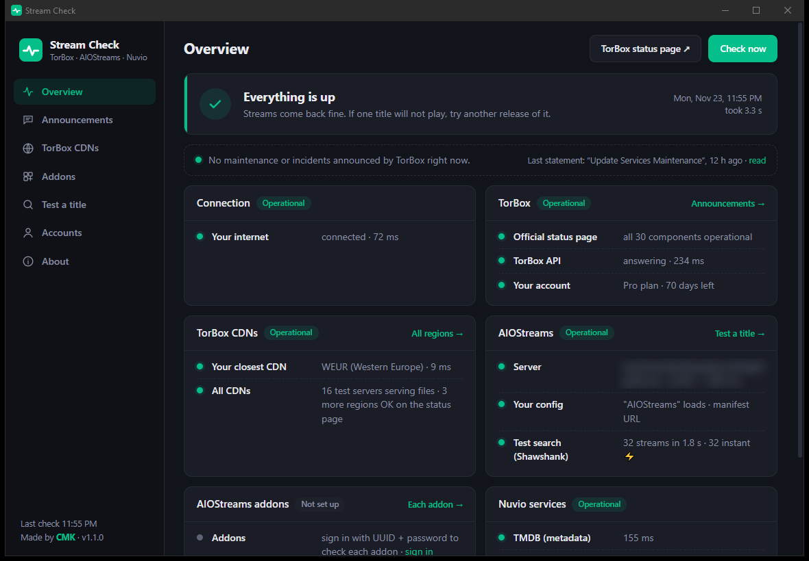
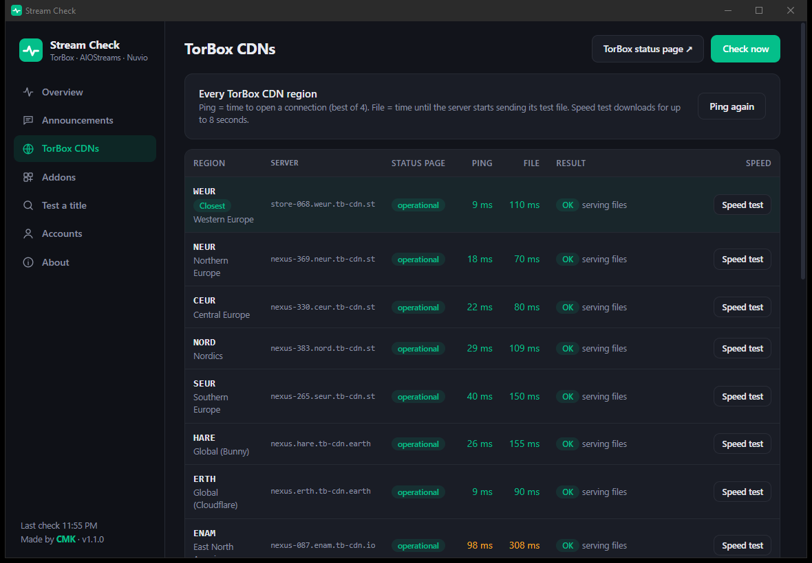
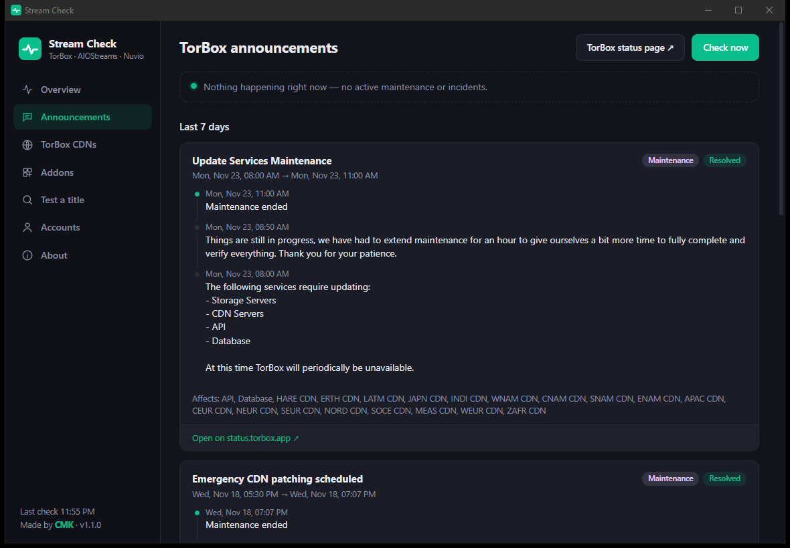

<p align="center">
  
</p>

<h1 align="center">Stream Check</h1>

<p align="center">
  <b>Something won't play? One tap tells you what's down.</b><br />
  TorBox · every TorBox CDN · AIOStreams and each of its addons · Nuvio's services · your own internet<br />
  <br />
  Windows &amp; Android · free &amp; open source · made by <b>CMK</b>
</p>

<p align="center">
  <a href="https://github.com/CandyManKillerZ/stream-check/releases/latest"><b>⬇ Download the latest release</b></a>
</p>

---

When you stream with **Nuvio + TorBox + AIOStreams**, a video that won't start could be caused by any of them, or by a single scraper inside AIOStreams, or by a TorBox CDN in your region, or just by your own connection. Checking each one by hand takes ages. Stream Check checks all of them at once (in a few seconds) and tells you, in one sentence, where the problem is.



## What it checks

| | What Stream Check looks at |
|---|---|
| **Your internet** | Whether you are online at all, so you don't blame a service for your own connection. |
| **TorBox** | TorBox's **official status page** (all 30 components), whether the **TorBox API** answers, and your **account** (plan, days left, whether your API key still works). |
| **TorBox statements** | When TorBox announces **maintenance or an incident**, their statement is shown in full, with the whole timeline of updates and what is affected. Planned maintenance shows up before it starts. |
| **Every TorBox CDN** | All regions: ping, how fast each server starts sending a file, what the status page says about it, your **closest** region, and an on-demand **speed test** per region. |
| **AIOStreams** | Whether your AIOStreams server is up, whether your config still loads, and a **real test search**: the same request Nuvio makes. |
| **AIOStreams addons** | Every scraper in your config (Comet, Torrentio, MediaFusion, StremThru, …): how many streams each one **found**, how many of those **reach Nuvio** after AIOStreams removes duplicates and applies your filters, and which ones **time out or fail**, with the error. Subtitle and metadata addons are recognised and skipped; anime-only scrapers can get their own **anime test**. |
| **Nuvio** | The metadata services Nuvio relies on (TMDB, Cinemeta) and the Nuvio website. |
| **Wi-Fi pairing** | Signed in on your PC? Scan one QR code with your phone and it is signed in too: sent directly over your Wi-Fi, encrypted, only after you click Allow. |
| **Test a title** | Paste an IMDb link or id (or a show with season + episode) to see whether *that exact title* finds streams, and from which addons. |

| TorBox CDNs | TorBox announcements |
|---|---|
|  |  |

## Download & install

Grab the files from the [**latest release**](https://github.com/CandyManKillerZ/stream-check/releases/latest).

### Windows
1. Download `StreamCheck-<version>-windows-x64.exe`.
2. Double-click it. It is a single program with nothing to install.
3. Windows may say *"Windows protected your PC"* because the app is not code-signed (signing certificates cost money). Click **More info → Run anyway**.
   If nothing happens at all, right-click the file → **Properties** → tick **Unblock** → **OK**.

Requires Windows 10 or 11 with Microsoft Edge WebView2. It is already on almost every PC; if it is missing, Windows offers to install it.

### Android
1. Download `StreamCheck-<version>-android.apk` on your phone.
2. Open it. Android will ask you to allow installing apps from your browser or file manager. Allow it once.
3. Tap **Install**.

Requires Android 7.0 or newer.

## Signing in

Open **Accounts** in the app.

- **TorBox:** paste your **API key** (torbox.app → Settings → API Key). TorBox has no password login for apps; the API key *is* the login.
- **AIOStreams:** two options:
  - **UUID + password** *(recommended)*: your server address, plus the UUID and password from your AIOStreams configure page. This turns on the **per-addon checks**.
  - **Manifest URL:** the install URL you added to Nuvio. Checks AIOStreams as a whole, but not each addon.

You can use Stream Check without signing in; it then checks everything that is public (TorBox status, CDNs, Nuvio's services).

### Sign in on your phone with one scan (Wi-Fi pairing)

Already signed in on your PC? You don't have to type anything on your phone:

1. On the PC: **Accounts → Show QR code**.
2. On the phone: open Stream Check → **Accounts → Scan QR code**. (No app yet? Scan the code with your normal camera; the page that opens offers the download, then **Open in Stream Check**.)
3. On the PC, check the phone's name and click **Allow**.

How it stays safe:
- Your sign-ins travel **directly from your PC to your phone over your own Wi-Fi**. Nothing goes through the internet or any server.
- They are encrypted with a one-time key that exists **only inside the QR code**, never on the network.
- Nothing is sent until you click **Allow** on the PC, and you see which phone is asking.
- The QR code works **once** and for **2 minutes**; after that the PC stops listening.

Both devices must be on the same Wi-Fi. The first time, Windows asks whether Stream Check may use the network: allow it on **private networks**. If your PC runs a VPN, allow "local network access" in the VPN's settings.

## Your data stays on your device

- Your API key, UUID and password are stored **only on your device**, encrypted: with **Windows DPAPI** on PC (only your Windows account can read them) and the **Android Keystore** on phones.
- They are sent **only** to TorBox (`api.torbox.app`), to **your own** AIOStreams server and, when you pair a phone and click Allow, **directly to that phone over your Wi-Fi**. Never anywhere else.
- Stream Check has **no server of its own**, no analytics and no tracking. Everything happens on your device.

## FAQ

**The Nuvio website shows "unreachable". Is Nuvio broken?**
Not necessarily. Nuvio runs on your device; its website being down does not stop playback. That is why it is shown as *info*, not as an error.

**An addon found hundreds of streams but only 1 is "in Nuvio". Is it broken?**
No. When several scrapers find the same release, AIOStreams keeps only one copy, and your filters remove the rest. The **Found** column shows what each scraper really returned. To get those numbers, Stream Check sends a temporary copy of your config, with duplicate removal and filters switched off, to **your own** AIOStreams server for that one search. Nothing is saved.

**What do Skipped, Normal and Found nothing mean?**
*Skipped*: a subtitles or metadata addon, which never returns streams. *Normal*: nothing found is expected (anime-only scraper on a movie, your TorBox library, live TV). *Found nothing*: a general scraper returned nothing for a popular movie, which usually means it is down or blocked. *Failing*: AIOStreams reported an error or timeout for it.

**Why is "Ping" a TCP ping?**
Most CDNs block classic ICMP ping. Stream Check measures how long it takes to open a connection, which is exactly what your player does first.

**Some regions have no ping.**
TorBox publishes a test server for most regions but not all. For those, Stream Check shows the status-page result only.

## Build it yourself

Everything (checks, UI, logic) lives in [`web/`](web) and is shared by both apps. Each platform only adds a thin native layer for things a web page cannot do (cross-site requests, TCP ping, speed test, encrypted storage).

```
web/        shared UI + all check logic (core.js), platform adapter (platform.js)
desktop/    Windows app: Go + Wails (native.go, store.go, pair.go = Wi-Fi pairing)
android/    Android app: Capacitor 8 + NetProbe plugin (Java)
scripts/    build scripts
docs/       GitHub Pages: the page the pairing QR code opens on phones (docs/pair/)
```

Third-party code: [jsQR](https://github.com/cozmo/jsQR) (Apache-2.0, `web/vendor/`), [go-qrcode](https://github.com/skip2/go-qrcode) (MIT), Wails, Capacitor.

**Windows**: needs [Go 1.23+](https://go.dev/dl/), [Node.js 18+](https://nodejs.org/) and the [Wails CLI](https://wails.io/docs/gettingstarted/installation):
```powershell
.\scripts\build-windows.ps1        # -> dist\StreamCheck-<version>-windows-x64.exe
```

**Android**: needs Node.js 18+ and [Android Studio](https://developer.android.com/studio) (its SDK and bundled JDK):
```powershell
npm install
.\scripts\build-android.ps1 -Debug # -> dist\StreamCheck-<version>-android-debug.apk
```
For a signed release build, create `android/keystore.properties` (it is gitignored, never commit it):
```properties
storeFile=C:/path/to/your-release.jks
storePassword=...
keyAlias=...
keyPassword=...
```
then run `.\scripts\build-android.ps1`.

## Disclaimer

Stream Check is an independent, unofficial tool. It is not made by, endorsed by, or affiliated with TorBox, AIOStreams, Nuvio, TMDB or Stremio. All product names belong to their owners. Stream Check only reads public status information and the accounts *you* sign in with.

## License

[MIT](LICENSE) © CMK

<p align="center"><sub>Made by <b>CMK</b></sub></p>
